<p align="center">
  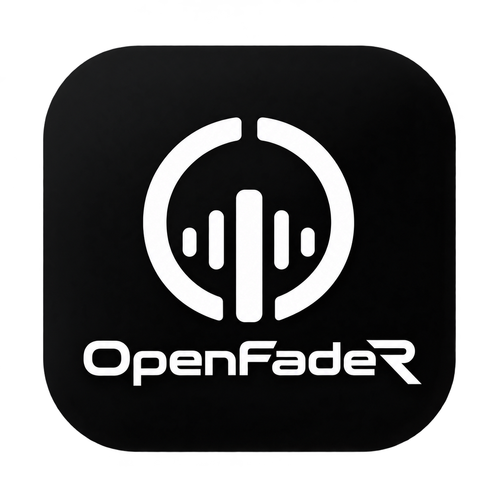
</p>

<h1 align="center">OpenFadeR</h1>

<p align="center">
  <b>Free, open-source DJ software for Linux, Windows, macOS and Raspberry Pi.</b><br>
  Two or four decks, stems, effects, a sampler and USB export, with a mouse, a keyboard or a MIDI controller.
</p>

<p align="center">
  <a href="https://github.com/OpenRsG/OpenFadeR/releases/latest"></a>
  <a href="https://github.com/OpenRsG/OpenFadeR/releases"></a>
  <a href="https://github.com/OpenRsG/OpenFadeR/actions/workflows/ci.yml"></a>
  <a href="LICENSE"></a>
</p>

<p align="center">
  <a href="https://github.com/OpenRsG/OpenFadeR/releases/latest"></a>
</p>

<p align="center">
  <a href="#download">Download</a> ·
  <a href="#quick-start">Quick start</a> ·
  <a href="#feature-tour">Feature tour</a> ·
  <a href="#documentation">Documentation</a> ·
  <a href="https://github.com/OpenRsG/OpenFadeR/issues">Report a bug</a>
</p>

<p align="center">
  <a href="docs/media/hero.png">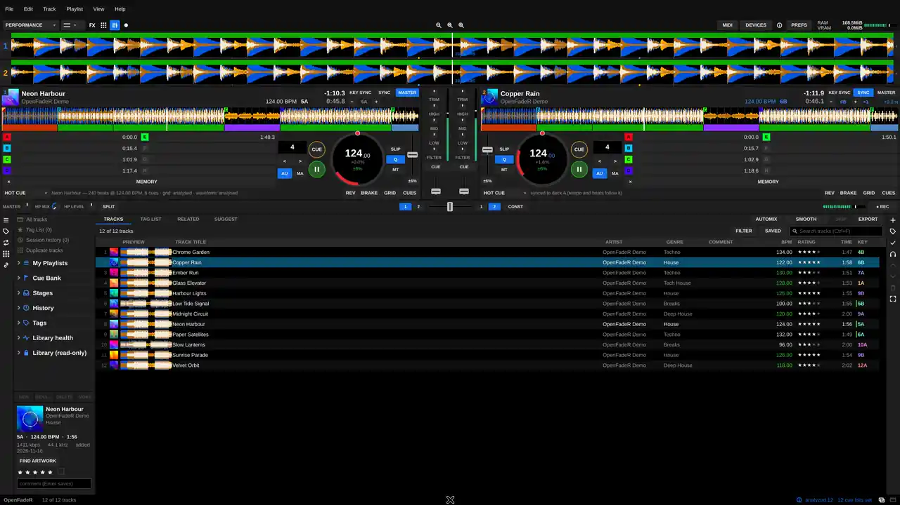</a>
</p>

<p align="center">
  <a href="docs/media/demo.mp4">Watch the demo as MP4</a> · <a href="docs/media/hero.png">Full-size screenshot</a>
</p>

- **Runs where you play.** One program for a Linux, Windows or macOS laptop and for a Raspberry Pi. It is written in Rust with a Slint interface.
- **Reads the library you already have.** Adapters cover Rekordbox, Traktor, Engine DJ, Serato, VirtualDJ and iTunes / Music.
- **Prepares USB sticks for DJ players.** The EXPORT workspace writes tracks and cue points in the device format of supported players.
- **Works with your controller.** A matching installed MIDI mapping loads when the controller connects.
- **Free to use and to change.** The license is [AGPL-3.0](LICENSE).

## Download

There is no installer. Take the archive for your system from the [latest release](https://github.com/OpenRsG/OpenFadeR/releases/latest), extract it and run OpenFadeR from the extracted folder. Keep the companion folders with the executable.

| System | Build | Archive |
| --- | --- | --- |
| Windows PC | x86_64 | `openfader-<version>-windows-x86_64.zip` |
| macOS | Apple Silicon (arm64) | `OpenFadeR-<version>-macos-arm64.zip` |
| Linux PC | x86_64 | `openfader-<version>-linux-x86_64.tar.gz` |
| Raspberry Pi / ARM Linux | aarch64 | `openfader-<version>-linux-aarch64-pi.tar.gz` |
| Raspberry Pi 4 / CM4 | Cortex-A72 build | `openfader-<version>-linux-aarch64-pi4.tar.gz` |

Windows builds are unsigned. macOS builds are ad-hoc signed, not Developer ID signed or notarized, so the OS may require you to approve them before launch.

The Pi builds need a 64-bit OS based on Debian 13 (trixie). See the [Raspberry Pi guide](docs/raspberry-pi.md) for dependencies and setup. Prebuilt archives avoid compiling Rust on the Pi.

Use Help > Check for updates to check for a newer release. The [release notes](docs/releases/) describe changes and any upgrade requirements.

## Quick start

1. Open Preferences > Audio and select your audio output.
2. Open a folder of music, or add a library source in Preferences > Music libraries.
3. Select a track in the browser. Enter loads deck A; Shift+Enter loads deck B.
4. Space starts or pauses deck A; Shift+Space controls deck B. Use the channel faders to set their levels.

Press `?` for the shortcut list. Change bindings in Preferences > Keyboard shortcuts.

For a MIDI controller, OpenFadeR loads a matching installed mapping when it connects. Preferences > Decks & controllers > Get mappings installs additional mappings. See the [controller guide](docs/mappings.md) for setup and soft takeover.

### Crossfader control

Preferences > Decks & controllers > Mixer > Enable crossfader. Clear it to ignore manual crossfader input and leave both mix sides open. Channel faders still work, and Automix keeps its automatic transitions. Re-enabling applies the crossfader position again.

## Feature tour

Screenshots are from release 0.2.13 with the Rek theme and a generated demo library. Controls can differ between releases.

### Two or four decks

- Scrolling waveforms with phrase markers, hot cues, loops, slip mode and quantize.
- Tempo sync and key sync between decks.
- Horizontal or vertical layouts for two or four decks, plus a Browse layout.

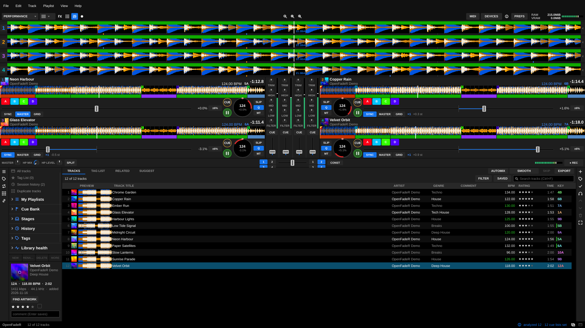

### Effects

- Channel EQ and a filter on every channel.
- Color FX and Beat FX beside the decks.
- Release, Merge, Send, Lever and Mic FX in the same panel.

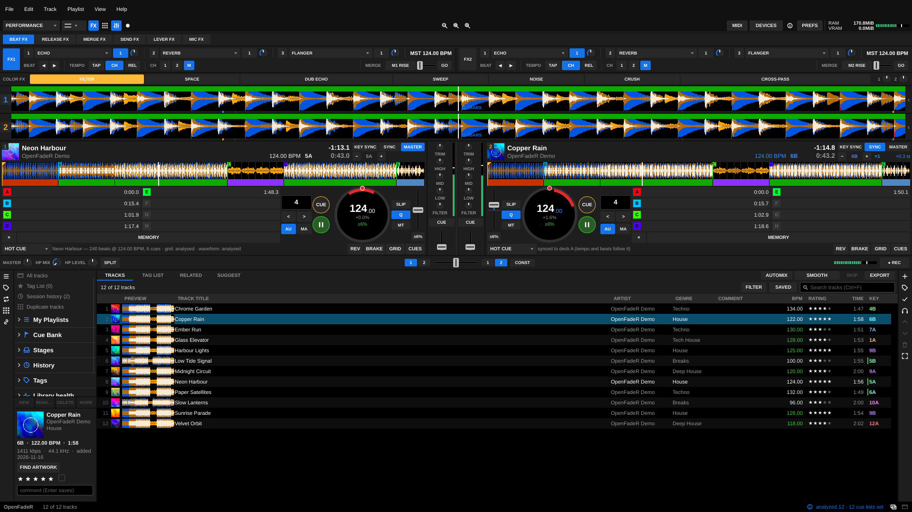

### STEMS

Separate a track into vocal, instrumental, bass and drum parts and mix each one. Mute or solo a part from its button, a pad or a controller.

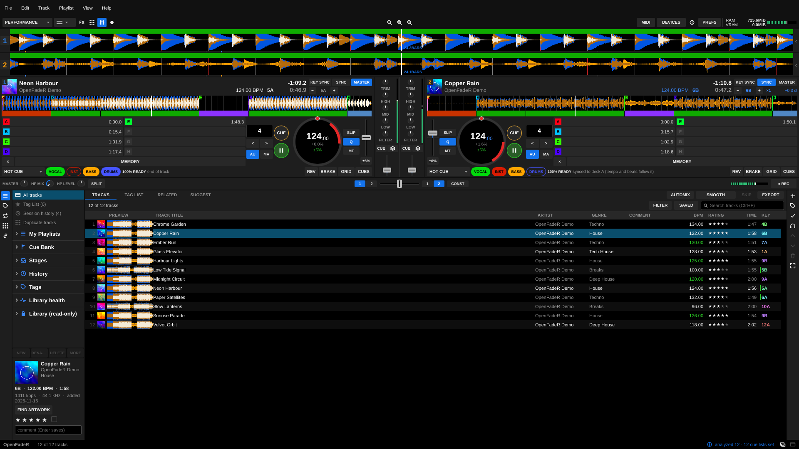

The first use downloads a 316 MB model, and separation needs additional CPU or GPU memory. It starts when you first use a stem control on that deck (a part button, pad, isolator knob, FX part or instant doubles), so tracks played as the mix cost nothing, and cached stems load at once.

Preferences > Creative tools > STEMS PROCESSING chooses where separation runs. AUTO uses the graphics card except on a Windows machine whose only graphics adapter is an integrated one (there the desktop would freeze while a segment runs; `OPENFADER_STEMS_GPU=1` overrides that check). CPU never uses it. ARM Linux builds use the CPU provider; see the [Pi guide](docs/raspberry-pi.md) before enabling it on a small board.

### Sampler and sequencer

Trigger samples and work with sequences from the performance workspace. The sampler and sequencer add sample playback and saved patterns.

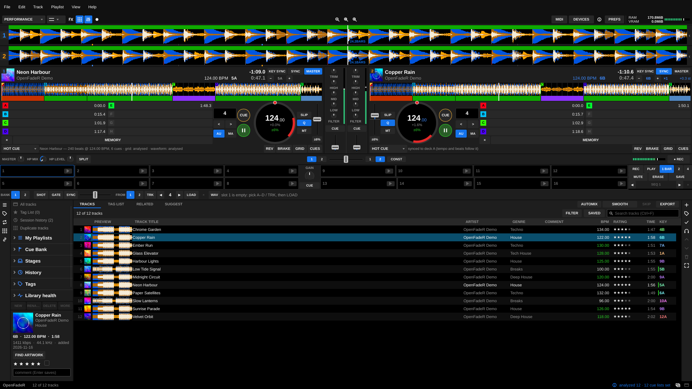

### Beat Lab and track preparation

Inspect waveforms and adjust beat grids before mixing. Cues, loops and track metadata stay in the library. Beat Lab adds loop slots under the decks, and CAPTURE takes a loop from the playing deck into a slot.

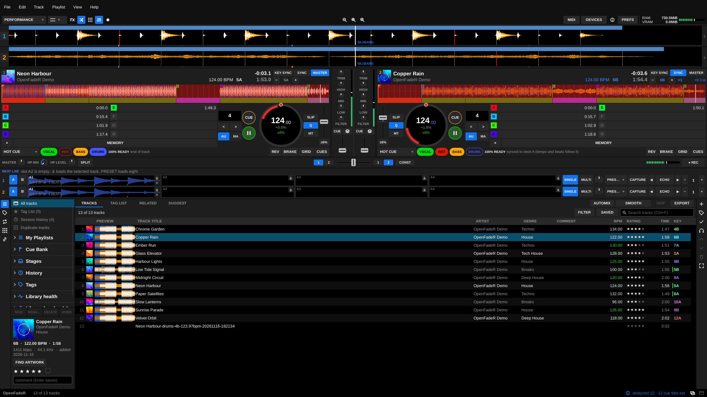

In a deck's **GRID** panel, type the known tempo in **BPM** and press Enter (30–300 BPM; `.` or `,` for decimals). It changes the beat grid, not the playback tempo fader. The beat nearest the playhead stays anchored; with **HERE** on, only the current tempo section changes. The edit is saved with the track; Analysis Lock prevents changes. EXPORT mode offers the same BPM entry with UNDO / REDO.

### EDIT workspace

Arrange edits on the timeline, use snapping and export the result as WAV. The edit-decision list works over the source audio.

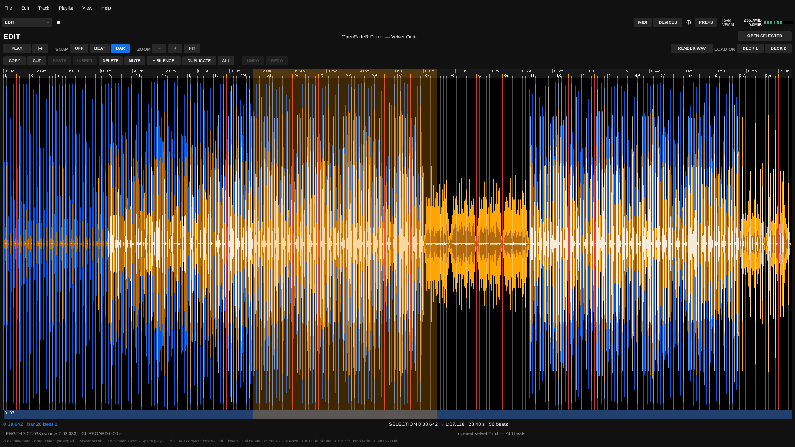

### USB export for DJ players

Use the EXPORT workspace to prepare tracks and cue points for supported DJ players. Library adapters handle each format's device files.

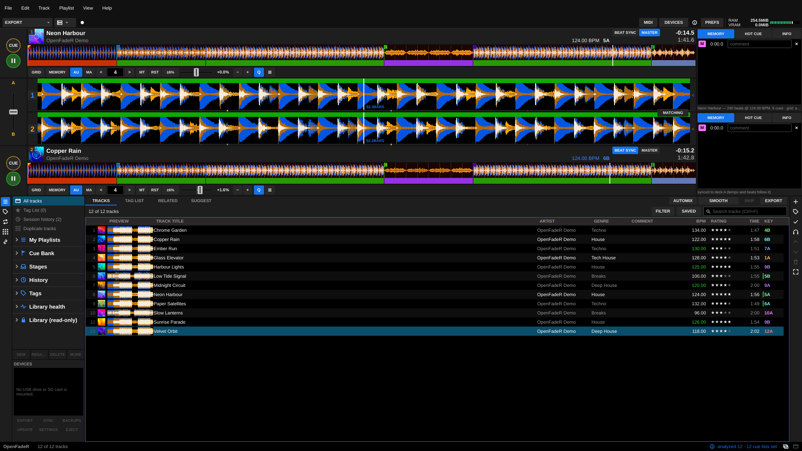

Back up a USB device before exporting to it, and test the exported library on your player before a gig. Format support varies by player and firmware; check the [Rekordbox device compatibility table](compatibility/rekordbox/device/COMPATIBILITY.md) and the [adapter guide](docs/plugins.md#compatibility-layer).

### Themes and layouts

Choose a theme in Preferences or install one from a repository. The release archive includes Rek, Rek Light, Catppuccin, Dracula, Nord, Gruvbox Dark, Tokyo Night and others. Desktop, Stage and Pocket layouts share the same library and playback state. The [skin guide](docs/skins.md) covers the shared token schema, named choices and minimal theme files. The Studio theme has been removed.

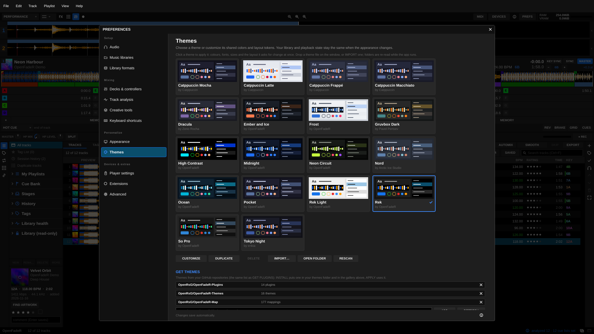

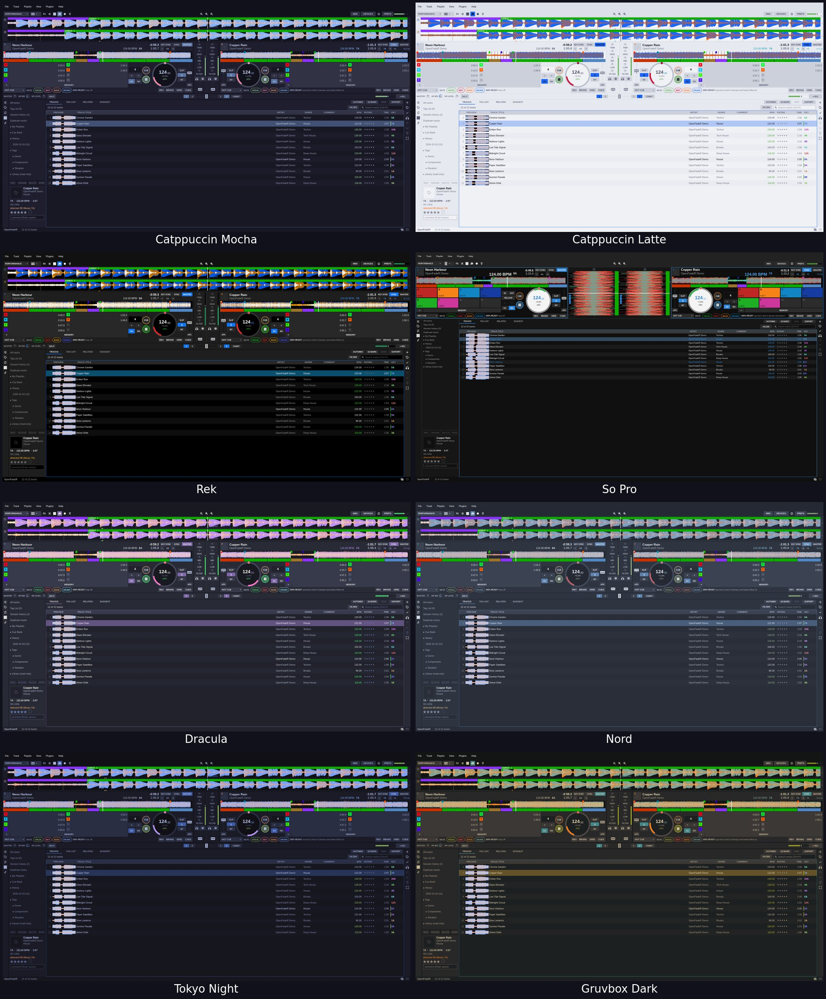

### Also included

- Automix and mix recording from the main workspace. See the [recording guide](docs/recording-files.md) for recorded files.
- A SUGGEST view that lists suggested tracks for the loaded one while the decks stay visible.
- A LIGHTING workspace with fixture and DMX scene controls. Lighting tools are beta.
- A separate workspace for video playback.

<details>
<summary>More screenshots: track suggestions and lighting (Catppuccin Mocha theme)</summary>

#### Track suggestions

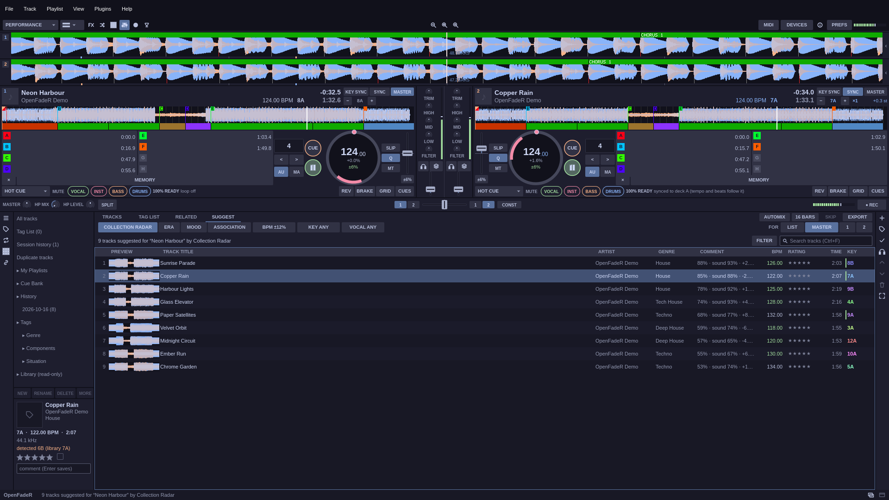

#### Lighting

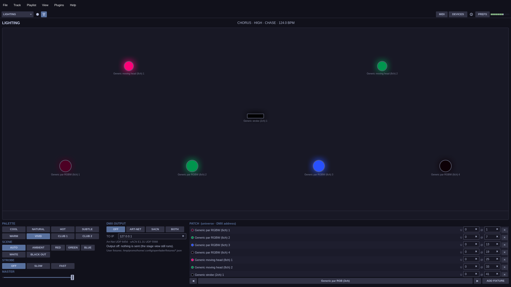

</details>

## Library and controller support

OpenFadeR keeps its Collection in its own database. Adapters read external libraries and perform the operations supported by each format.

| Integration | Delivery |
| --- | --- |
| Rekordbox device libraries, XML and desktop collection | Built-in adapters |
| Traktor collections | Optional built-in adapter |
| Engine DJ, Serato, VirtualDJ and iTunes / Music | Optional built-in compatibility adapters |
| Sampler packs | Companion `sample-pack` plugin |
| Mixxx controller mappings and scripts | Companion controller plugin, not a library reader |

The [compatibility-layer guide](docs/plugins.md#compatibility-layer) lists formats and supported read/write operations. [OpenFadeR-Plugins](https://github.com/OpenRsG/OpenFadeR-Plugins) contains the companion integrations.

MIDI support does not mean that every controller's audio interface is configured automatically. Select the audio output separately in Preferences > Audio when needed.

Preferences separates native compatibility in Library formats, STEMS/Beat Lab/video/lighting in Creative tools, and optional add-ons in Extensions. Pages have scoped setting search, group selection and clickable help. Turning off a format does not remove imported tracks from the Collection.

## Build from source

Install Git, Python 3, stable Rust and your platform's native build tools. Linux also needs pkg-config and development packages for ALSA, fontconfig, XKB, Wayland and udev; the [CI workflow](.github/workflows/ci.yml) lists the Ubuntu packages.

```sh
git clone https://github.com/OpenRsG/OpenFadeR.git
cd OpenFadeR
./start.sh ~/Music
```

`start.sh` fetches the companion repositories on the first run, builds native plugins and starts a release build. It uses plugin tag `v0.2.12` by default. Existing companion checkouts are left as they are; update them deliberately when changing core versions.

On machines with little RAM, set `CARGO_BUILD_JOBS=1` to limit compiler parallelism. The [Pi guide](docs/raspberry-pi.md) also covers cross-compilation. Android has a separate [build guide](docs/android.md).

On Linux, `./install.sh` builds and installs for the current user. `./install.sh --uninstall` removes that installation. See [CONTRIBUTING.md](CONTRIBUTING.md) for development and test instructions.

## Plugins, themes and controllers

Companion repositories are checked out into these folders when running from source:

| Repository | Folder | Documentation |
| --- | --- | --- |
| [OpenFadeR-Plugins](https://github.com/OpenRsG/OpenFadeR-Plugins) | `extension/plugin` | [Plugin guide](docs/plugins.md) |
| [OpenFadeR-Themes](https://github.com/OpenRsG/OpenFadeR-Themes) | `extension/skin` | [Skin guide](docs/skins.md) |
| [OpenFadeR-Map](https://github.com/OpenRsG/OpenFadeR-Map) | `mappings` | [Controller mapping guide](docs/mappings.md) |

Use the [SDK](sdk/) to write a native plugin. Use a controller mapping compatible with your hardware; the [mapping guide](docs/mappings.md) describes installation and input behavior.

## Backups and bug reports

File > Library > Backup library saves OpenFadeR's library, and the music files too when you answer yes to its question. Make a backup before major upgrades. [Backup, export and sync](docs/backup-export-sync.md) explains which of the three to use, also between two computers.

For a bug report, use Help > Report a problem and include the steps to reproduce it. The [diagnostics guide](docs/diagnostics.md) explains logs, crash reports and what the report contains. Check reports for private information before posting them publicly.

## Documentation

- [Raspberry Pi setup](docs/raspberry-pi.md)
- [Controller mappings](docs/mappings.md)
- [Plugins and library adapters](docs/plugins.md)
- [Themes and skins](docs/skins.md)
- [Library format and import/export](docs/library-format.md)
- [Backup, export and sync](docs/backup-export-sync.md)
- [Recording files](docs/recording-files.md)
- [Key detection](docs/key-detector.md)
- [Diagnostics and bug reports](docs/diagnostics.md)
- [Release notes](docs/releases/)
- [Code structure](docs/code-structure.md)
- [Contributing](CONTRIBUTING.md)
- [Security policy](SECURITY.md)
- [Code of conduct](CODE_OF_CONDUCT.md)

## License

[AGPL-3.0](LICENSE). Maintained by [OpenRsG](https://github.com/OpenRsG).
