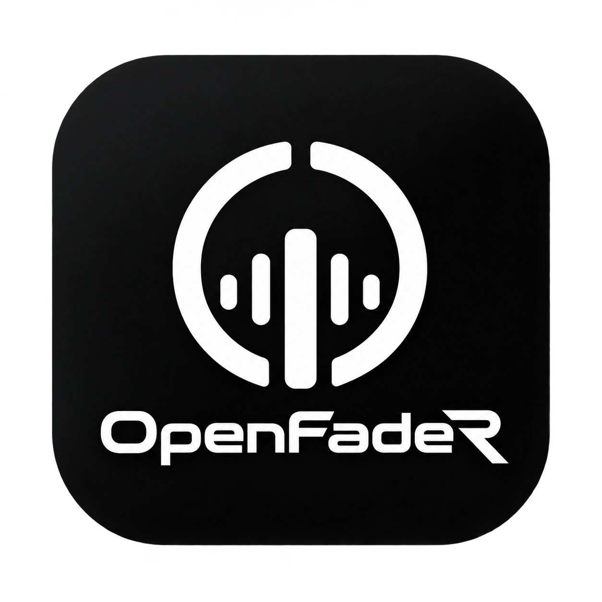

<p align="center">
  
</p>

<h1 align="center">OpenFadeR</h1>

<p align="center">
  
</p>

<p align="center">
  <a href="LICENSE"></a>
  <a href="https://github.com/OpenRsG/OpenFadeR/stargazers"></a>
</p>

OpenFadeR is an open-source DJ application for two or four decks, written in Rust with [Slint](https://slint.dev). It analyses your tracks, separates stems, mixes with effects and a sampler, and reads MIDI controllers from a growing set of mapping files. Themes, plugins and controller mappings install from GitHub repositories with one click.

<p align="center">
  
</p>

<p align="center"><a href="docs/media/demo.mp4">Watch the demo as MP4</a></p>

Every screenshot on this page comes from the running app, with a library of synthetic tracks generated for these pictures. There is no copyrighted music in them.

## Download

Get the archive for your system from the [releases page](https://github.com/OpenRsG/OpenFadeR/releases): Linux (x86_64), Windows (x86_64) or macOS (Apple silicon). Each holds the app with its themes, controller mappings and plugins. Unpack it and run `openfader` (macOS: right-click `OpenFadeR.app` > Open the first time, the app is not signed). This is a pre-release: please report what does not work.

### Updates

At start, once a day, the app asks GitHub for the latest release (PREFERENCES > ADVANCED > OTHERS > Check for updates, on by default; nothing else is sent). A newer one shows a notice, and Help > Update to … (or Help > Check for Updates, which asks at once) opens its release notes, version and download size with UPDATE NOW, SKIP THIS VERSION and LATER. UPDATE NOW downloads the archive for your system (Linux x86_64, Raspberry Pi, Windows, macOS Apple silicon) with a progress bar, refuses it unless its SHA-256 is the digest GitHub lists for that file, unpacks it next to the install, swaps it in and restarts. Your settings, library and add-ons live in your per-user folders and are not touched; the version you had stays in `<install folder>.prev` (for `./install.sh`: `~/.local/lib/openfader.prev`). Help > Roll Back to … puts it back; if the new version does not start, `openfader --rollback` (from a terminal) does the same. An install the app cannot or must not replace (a package manager's, under `/usr`, a read-only folder, a build in a source tree) opens the release page instead. The same check counts the installed plugins that GET PLUGINS lists in a newer version. `OPENFADER_UPDATE_API` points the check at another API root (a mirror or a test server).

## Build from source

You need `git` and a [Rust toolchain](https://rustup.rs).

```sh
git clone https://github.com/OpenRsG/OpenFadeR.git
cd OpenFadeR
./start.sh ~/Music
```

The first run clones the plugins, themes and mappings next to the code, builds everything and connects the folder you gave to the Collection. You should see your tracks in the browser, with BPM, key and waveform previews filling in as the analysis finishes. Double-click a track to load it on deck 1, press `Space` to play.

`start.sh` without a path opens the Collection as you left it; every connected library and folder syncs at start and whenever it changes, and `$XDG_MUSIC_DIR` (else `~/Music/OpenFadeR`) is always connected. To build only the core: `cargo build --release`.

To install it for your user on Linux instead (the `openfader` command and an application menu entry, with the plugins, themes and mappings bundled): `./install.sh`. It also sets the default plugin, theme and mapping repositories of PREFERENCES (GET PLUGINS / GET THEMES / GET MAPPINGS), which the app uses anyway until you edit the list. Run it again to update; `./install.sh --uninstall` removes it.

### Raspberry Pi

For a Raspberry Pi 3, 4 or CM4 (64-bit Raspberry Pi OS, Debian 13), `docker buildx build -f Dockerfile.pi -o dist/pi .` cross-compiles an optimised archive on any x86_64 machine. See [docs/raspberry-pi.md](docs/raspberry-pi.md) for memory use (about 200 MB with two tracks playing, software renderer) and settings.

### Android

The standalone phone/tablet app lives in [`mobile/`](mobile/): two decks, local music import, waveforms, cues, loops, sync, EQ and effects, using the shared Rust engine with a touch-first Slint UI. It excludes video, lighting and Beat Lab. See [Android build and usage](docs/android.md) for APK packaging, supported features and lifecycle behavior.


## A tour

### Analysis that is ready when you load

BPM, beat grid, downbeat, key, a three-band waveform, phrases (intro, up, chorus, down) and automatic cues are computed in the background and cached. The pictures above show them: coloured phrase bars over the enlarged waveforms, hot cues A to H under each deck, and a key colour in the track list. Decks sync tempo and beats, key sync follows the key, and key lock keeps the pitch while you push the tempo.

Loading publishes playable audio after decoding and preparing its initial gain and auto-cue position. Missing waveform, grid and key analysis can finish during playback without replacing cue or grid edits made meanwhile. Bulk analysis requests share a worker budget; replacing a deck load or preview cancels obsolete work.

Tracks that change tempo (a live drummer, an edit, a deliberate tempo change) get a grid in tempo sections: PREFERENCES > ANALYSIS > Detect tempo changes (on by default) splits the grid where the tempo changes for good, and a steady track stays one section. The deck BPM readout, SYNC and its beat phase, quantize, loops, beat jump, Beat FX, the MIDI clock and AUTOMIX follow the section under the playhead; the browser BPM stays the first tempo. In GRID mode the HERE chip (FROM HERE in EXPORT mode) makes TAP, ×2, ÷2, a typed BPM and widen / narrow change only the tempo section from the playhead up to the next tempo change, so a tempo change at the playhead is HERE, then TAP; MERGE removes the section under the playhead, and UNDO brings it back. Grid edits (downbeat, double, halve, tap, shift) re-derive the track's phrases so they start on bar lines, unless you edited the phrases yourself. With PREFERENCES > ANALYSIS > BEAT GRID FROM set to LIBRARY, a track whose library supplies a grid keeps it after ANALYZE; the status line says so, and OPENFADER ANALYSIS shows our grid instead.

With PREFERENCES > ANALYSIS > KEY DETECTOR set to NEURAL, the key part runs a small convolutional network on the CPU instead of the chroma profiles. Its 1.8 MB model downloads once on first use (size and sha256 checked, progress on the track info status line); offline, the analysis stays CLASSIC and says so. See [docs/key-detector.md](docs/key-detector.md) for the model, its licence and measured accuracy.

SYNC follows tempo while a master deck loops. Beat-phase correction pauses when the loop does not span a whole number of follower beats, so short loops do not make other decks repeat. Phase correction resumes when the loop ends or returns to a whole-beat length.

The playing deck leads the tempo. SYNC on the only playing deck keeps its tempo and makes it the master; it never retunes an audible deck to follow an idle one. An idle deck follows a playing one. A deck you made MASTER with the MASTER button is followed even when it is idle.

For clearer waveforms, open PREFERENCES > VIEW > WAVEFORM. Set BEAT GRID to BOLD for outlined lines over the enlarged waveform, with wider downbeats that do not rely on colour alone. The whole-track overview keeps thin bar lines behind the audio in either setting, so track dynamics and phrases stay readable. Set HOT CUE MARKERS to LARGE for double-size flags and letters on the decks and browser previews (when preview cue markers are enabled). Memory cues are solid bars in the theme's memory-cue colour with an M flag, drawn over the grid and wider than a bold downbeat, and they grow with LARGE too. Both settings apply immediately and are saved; NORMAL keeps the original sizes.

The same WAVEFORM section has RENDERER: AUTO (default), GPU or CPU. AUTO uses cached images composed by a hardware renderer;
CPU retains the raster-overlay fallback. GPU also allows emulated OpenGL for diagnosis; without a graphics API it falls back
to CPU. Changes apply while playing, without restarting or interrupting audio. The startup log identifies the graphics API,
the OpenGL renderer and the waveform path. See [Raspberry Pi performance advice](docs/raspberry-pi.md#speed).

The interface is in English, French, Spanish, German, Portuguese (Brazil), Italian or Dutch: PREFERENCES > VIEW > LANGUAGE, where SYSTEM follows the computer's language. Button labels that match DJ hardware (CUE, SYNC, LOOP, BEAT FX …) stay in English in every language.

### Two decks or four

<p align="center"></p>

Press `D` to switch layouts. All four decks get their own pads, loops, slip, sync and stem buttons. The deck layout (horizontal or vertical) is a VIEW setting, and a theme can ask for it.

A four-deck controller (the DDJ-FLX6, for one) has two physical decks and DECK 1 / 2 / 3 / 4 buttons for the layer each one controls. In the 2-deck layout, DECK 3 / 4 keep the two decks on screen: the left (right) deck then draws deck 3 (4), its waveform, panel, pads, mixer channel and number, and DECK 1 / 2 bring decks 1 / 2 back. All four decks keep playing; when the deck on the other layer of a side is playing, a small box with its number sits next to the deck number. The 4-deck layout shows every deck at once and does not change with the layer. The number of a deck is drawn large on its waveform box, centred; PREFERENCES > VIEW > WAVEFORM > DECK NUMBER moves it to the top left.

### Automix transition styles

Start AUTOMIX on a three-track list (or any longer list), then click the style chip beside it to open the panel.
LENGTH sets 8, 16 or 32 bars. STYLE offers SMOOTH (the original crossfade and bass swap), BASS SWAP (a longer overlap),
FILTER (outgoing high-pass sweep), FILTER IN (incoming low-pass opening), ECHO OUT, REVERB OUT, CUT, BRAKE, LOOP OUT
and EQ BLEND (mids/highs first, bass later). CUT uses one bar, BRAKE two and the two FX throws four; the other styles use LENGTH.
The mixer shows the timed moves and restores borrowed controls when the transition ends. Set channel faders to your intended
on-air levels before starting; styles do not raise them for you.

RANDOM chooses separately for each transition, never the same style twice in a row. The lit RANDOM USES chips select its pool
(at least two remain enabled). PLAN shows the chosen style for each track; the running status also names it. Changing STYLE
or the pool redraws upcoming choices; a transition already running keeps its choice. The choice and pool are saved.
SKIP still mixes at the next downbeat, or completes an active transition. Mix points, short tracks and late analysis follow
the existing planner; without usable grids the outgoing track ends with a cut. All styles work offline on the CPU, including
Raspberry Pi. Plugins can add [JSON recipes](docs/plugins.md#automix-styles) using the same engine as the built-ins.

### Effects

<p align="center"></p>

Beat FX has several units with three slots each. A unit's tempo comes from the deck on its channel (CH, the default), from the master deck (MST), or from taps (TAP); a unit on MASTER follows the master deck. COLOR FX (filter, space, dub echo, sweep, noise, crush, cross-pass) sits on every channel and MERGE FX works on the whole mix. More effects arrive through effect plugins.

Effect replacements are prepared outside the audio callback. While a replacement is pending, that unit passes dry audio. Turning the selected effect off keeps its tail.

### AUX input

A line source (a turntable preamp, a phone, a synth) can join the mix as a fifth channel beside the microphone. In PREFERENCES > AUDIO > AUX INPUT tick Enable AUX input and pick the input device (SAME AS INPUT DEVICE uses the device of INPUT CHANNELS) and the channel pair. An AUX strip appears after the decks, on the desktop mixer and in the touch mixer: TRIM, HIGH / MID / LOW, a FILTER knob, the LEVEL fader, a headphone CUE and the AUX switch, which opens the input pair and lets the channel play (the pair stays closed while the strip is off). The strip's meter shows the level after the fader. Assign a Beat FX unit to AUX to apply its effects, including plugin effects, like on a deck. MASTER FX and the LEVER rack also hear it in their sum.

AUX DUCK LEVEL lowers the decks while the AUX is heard after its fader, talkover style (OFF, -6 … -24 dB; the decks' master paths, so the headphone cue is untouched), and AUX DUCK RELEASE sets how long they take to come back. The microphone's own talkover (TALKOVER MODE / TALKOVER LEVEL) ducks everything else, the AUX included. Controllers can map `aux-level`, `aux-cue` and `aux-on`. The AUX is mixed in the internal mixer only; the External mixer mode sends the decks raw and leaves it out. Where no input device is available, for example on a Raspberry Pi with nothing plugged in, the AUX switch reports the problem on the mixer bar and the rest of the app is unaffected.

### Sampler

<p align="center"></p>

Sixteen slots in two banks, loaded from a deck or from a file. Slots play as a shot or a gate, can follow the tempo, and a sequencer records and replays a pattern.

### Stems

<p align="center"></p>

Enable STEMS in PREFERENCES > EXTENSIONS and each loaded track is separated into vocal, instrument, bass and drums (a 3-stem mode exists too) by an ONNX model that runs on the CPU or the GPU. Switching STEMS on downloads that model once (316 MB), with a progress card at the bottom right. A deck's stem button is filled while its stem plays at full level; a click turns that stem off, another brings it back. The pads and a controller can mute or solo, and the mixer's knobs can act on stems. The waveform follows what you hear.

Stem buffers allocate on a worker while the original track remains playable. STEM INSTANT DOUBLES shares completed audio and stems between decks, with independent transport and stem gains.

**Stem files** (`.stem.mp4` / `.stem.m4a`: an MP4 with the stereo mix as its first audio track and four stem tracks after it, the part names in a JSON box) play their own parts. The mix plays as the track; with STEMS on, the four parts feed the stem buttons, pads and knobs exactly as separated stems would, with no model run and no cache entry (it needs no model download either). The parts are mapped by their names: vocals (vocal, vox, voice, acapella) to VOCAL, drums (drum, perc, kick) to DRUMS, bass to BASS, anything else to INST. When the names do not give each stem exactly once, the usual order applies: drums, bass, melody, vocals. The browser marks stem files with a STEMS badge, the track info lists their part names and a stem button's tooltip names its part. PREFERENCES > EXTENSIONS > STEMS > "Use the parts of stem files" (on by default) switches this off: the file then plays and separates like any other MP4. Without STEMS on, or with the setting off, a stem file is just its mix.

### BEAT LAB

<p align="center"></p>

BEAT LAB captures a few beats of a deck's drum stem into a slot. Fill the slots of a deck, swap between them, and drop drums from one track under the melody of another. It needs STEMS and is switched on in the same preferences page.

### A browser that suggests

<p align="center"></p>

The browser reads folders (subfolders become playlists) or library plugins, and has search, sortable columns, a track filter (BPM range, key match, rating), related tracks, a Tag List, smart playlists, history, a duplicate finder and a missing-file manager. The SUGGEST tab ranks the rest of your collection against the loaded track and shows a score for each, with filters for BPM and key. Your own edits (track fields, cues, loops, grid, rating, comment, colour) live in `store.db`.

Select several tracks like in a file manager: Ctrl+click adds or removes a row, Shift+click (or Shift+Up/Down/PageUp/PageDown/Home/End) selects the range from the last row you clicked, Ctrl+A selects every row shown and Esc goes back to the chosen row. A search or filter drops the rows it hides from the selection; a re-sort keeps it. Drag any selected row to carry the whole selection onto a playlist (tracks the playlist already holds are skipped and counted), the Tag List, a tag, a stage or a palette; a deck still loads just the dragged track. The right-click menu then starts with "N tracks selected" and acts on all of them (Add to Tag List, Add to playlist, New playlist from selection, palettes, Remove from list, Analyze, Analysis lock, Reload tag, Fetch missing artwork, Auto relocate, Remove from Collection with one confirmation); the items that need one track (Load to deck, Edit track details, Tags, Related tracks, Move up/down, Find artwork, Show in file manager, Relocate) are greyed out. The status line counts the selection.

Right-click a browser track and choose Edit track details, or use Track > Edit Track Details (touch themes: Actions > Selected track).
Edit the title, artist, album, genre, label and comment while working on a playlist. Save fields and comment or Enter saves the text,
including empty values. Rating and colour save immediately. Close discards unsaved text. Saved edits appear in Collection, playlists
and loaded decks without restarting playback, and survive restarting the app.

Descriptive fields require a local-file track; remote-only tracks still support comments, rating and colour. BPM/key use the
grid/analysis controls; file paths and technical properties are read-only. OpenFadeR stores overrides in `store.db` and leaves
audio-file tags unchanged. Explicitly enabled two-way library connections retain their existing write-back behavior.

**Make Auto Cue point.** Right-click the selected tracks > Make Auto Cue point (Track menu) gives them their automatic cues: the cue point (a memory cue) on the first sound at or above the AUTO CUE LEVEL (Preferences > Controller > Deck), and hot cues A to H on the phrase changes of the beat grid, where CUE Analysis puts them (Preferences > Analysis sets how many hot and memory cues). A track's cue point is its earliest memory cue that is not a loop. If some tracks already have a cue point or hot cues, a dialog asks: Replace moves the cue point and swaps the hot cues for the automatic ones (loops and other memory cues stay), Add missing gives a cue point to tracks without one and fills the empty pads; closing it cancels. With Preferences > Analysis > Prohibit overwriting CUEs on, existing cues are kept without asking. A track without a beat grid gets only the cue point: analyse it first. The tracks are decoded one at a time off the interface, progress is in the status line, choosing the item again stops it, and the whole batch is one undo step.

**Library health.** The browser's Library health node lists the problems of your Collection, one row per check with its number of tracks: missing file, corrupt or undecodable (a load or analysis of the file failed), not analysed, missing tags (title, artist, genre, key, BPM; the key and BPM of our analysis count), no artwork, no rating, very long (a mix or a podcast), probably not music (audiobook or podcast hints in the genre, folder or file type, "Chapter 3" titles, a long track with no beat), duplicates and low bitrate. Choose a row to list its tracks, then use the bar above the list: ANALYSE, RELOCATE (or AUTO RELOCATE ALL), EDIT TAGS, REMOVE, and IGNORE to hide a track from that one check. SHOW IGNORED lists what you hid and UN-IGNORE brings it back. The counts are worked out on a background thread a moment after an edit, an import, a relocation or a finished analysis; choosing the node, or RESCAN, looks at every file again. Preferences > Advanced > Browse > Library health sets the minutes from which a track is "very long" (default 20) and the kbps below which it is "low bitrate" (default 128); 0 switches either check off.

### Edit mode

<p align="center"></p>

EDIT shows the whole track with its beat grid. Select with snap to beat or bar, then copy, cut, paste, insert, delete, mute, duplicate or add silence, undo and redo, and render the result to a WAV file or load it on a deck.

### Recording

REC writes the master mix (or an audio input) to WAV files, started and split by silence if you like. Next to each file it also writes a cue sheet and a tracklist of what led the mix (by the master deck, the channel faders and the crossfader), and, if you switch it on, a JSON-lines log of every deck, mixer and effect control you touched. See [docs/recording-files.md](docs/recording-files.md); the three are switched in PREFERENCES > ADVANCED > RECORDINGS.

### Lighting mode (beta)

<p align="center"></p>

LIGHTING patches fixtures (RGB pars, RGBW pars, moving heads, strobes) and drives them from the phrase that is playing, so a chorus looks different from a breakdown. Pick a palette and a scene, or let AUTO choose. DMX goes out over Art-Net or sACN, or nowhere: the stage view works without any hardware. It is disabled by default: turn it on in PREFERENCES > EXTENSIONS to add LIGHTING to the mode menu.

### Export and video

EXPORT mode shows cues and memory points for the two decks next to a DEVICES panel. USB sticks and SD cards are written by device plugins, several formats side by side on one stick sharing one copy of the audio, so the same stick plays on different players and apps. A track that is both in the collection and on a stick keeps the same cues, grid and phrases on both copies: plugging the stick in fills the copy that has none, and loading a track makes the copy you loaded win. A track that is only on the stick is saved back to it: cues set on it (a deck edit, Make Auto Cue point) are written into the stick's own library a few seconds later, in every format picked for that stick, and its colour and rating stay as they were.

Sending tracks to a stick takes no export window: drag them onto the device in the browser's tree (or onto one of its playlists: they join what it holds), drag a playlist onto the device, or right-click and choose **Transfer to** the device. A blank stick is listed under Devices too; the first transfer creates its library. A playlist the stick already holds under the same name takes the collection's version. Tracks without a beat grid or a key are analysed first; then they are written with their cues, grid, waveform and key in every format picked for the device, and the stick shows them in the tree when it is done.

<p align="center"></p>

VIDEO (beta) plays video tracks on an output window and crossfades between the two decks' pictures. It is disabled by default: like LIGHTING, it shows in the mode menu once turned on in PREFERENCES > EXTENSIONS.

### New music in steps: INBOX → REVIEW → COLLECTION

Name the folders you download to (PREFERENCES > ADVANCED > DATABASE > INBOX) and the app watches them while it runs: a new audio file, or a zip with audio (unpacked beside the zip), appears in **INBOX** in the browser's **Stages** node, analysed as after an import. Nothing is in the Collection until you move it: drag a track onto REVIEW or COLLECTION, or use MORE on a stage to move the chosen track or every shown one. The stage names are yours (RENAME) and + NEW adds more before COLLECTION. With "Move the file with the track" the file goes to a folder per stage under your library root, by a pattern such as `{artist}/{album}/{file}`, and never over another file (a taken name gets ` (2)`). A file the Collection has already (same path or same audio) is linked, not added twice. Every move is one step: Edit > Undo, or MORE > Recent moves, puts the files, stages and paths back. Plugins hear `inbox_added` and `inbox_moved`.

### Your library is yours

The Collection is OpenFadeR's own database. Other apps' libraries connect to it through library plugins (PREFERENCES > LIBRARIES) and are synced in; a format that holds less than the Collection (fewer hot cues, no loops, a smaller colour palette) is written from a fitted copy, and the status line says what did not fit. File > Export Collection also writes an open JSON file, a CSV table and an M3U8 playlist, described with the database tables in [docs/library-format.md](docs/library-format.md).

Track > Find Artwork… asks the artwork plugins (`cover-art` covers MusicBrainz, iTunes and Discogs) for covers, shows them to pick from, and keeps the chosen one for the album; Fetch Missing Artwork does it for a whole list. Folder images beside the files count too. See [Artwork plugins](docs/plugins.md#artwork).

## Themes

<p align="center"></p>

The app ships with Catppuccin Mocha (the default) and Latte. The [OpenFadeR-Themes](https://github.com/OpenRsG/OpenFadeR-Themes) repository adds eleven more, so there are 13 in total. A theme can change colours, fonts, sizes and even the layout, and it applies at once. PREFERENCES > THEMES has an editor for every token with live preview, SAVE AS, and import.

<p align="center"></p>

## Plugins, themes and mappings

Three companion repositories feed the app, and PREFERENCES lists them from the first run:

| Repository | Holds | Where in the app |
| --- | --- | --- |
| [OpenFadeR-Plugins](https://github.com/OpenRsG/OpenFadeR-Plugins) | library, device, effect, action, source and controller plugins (17 at the time of writing; `mixxx` runs Mixxx's `.midi.xml` mappings with their scripts from your own Mixxx folders) | PREFERENCES > EXTENSIONS > GET PLUGINS |
| [OpenFadeR-Themes](https://github.com/OpenRsG/OpenFadeR-Themes) | themes | PREFERENCES > THEMES > GET THEMES |
| [OpenFadeR-Map](https://github.com/OpenRsG/OpenFadeR-Map) | MIDI controller mappings (more than 170 files) | PREFERENCES > CONTROLLER > GET MAPPINGS |

INSTALL installs one. Add any repository by its GitHub path (`user/name`) and the app finds the plugins, themes or mappings in it too, so sharing a theme is publishing a GitHub repository.

Plugins start switched off. At the first start a welcome window offers the suggested ones (the plugins that read and write other DJ software's libraries, devices and effects) and STEMS; ACCEPT switches them on, SKIP leaves them off. Help > Welcome opens it again.

At each start the app asks GitHub for the newest release; when it is newer than the running version a window offers to open its download page. Offline, nothing is shown.

Plug in a controller that has no mapping yet and the app offers the matching file from the mapping repository: one click on INSTALL and the controller works. Mapping files cover the default layer of each controller; MIDI learn and LED feedback are built in, and hot-plug detection picks controllers up while the app runs. The format is described in [docs/mappings.md](docs/mappings.md).

External gear can follow the mix: name an output port in PREFERENCES > CONTROLLER > MIDI CLOCK OUT and it receives a 24 PPQN MIDI clock locked to the playing master deck's beat grid, with START on its next bar line and STOP when no deck plays. A deck without a beat grid sends no clock.

Knobs and faders that send absolute values use soft takeover: after the on-screen value changed (a layer switch, a mouse edit, a load) a control is ignored until it reaches that value, and a notification shows which way to turn it. PREFERENCES > CONTROLLER > Others > Soft takeover switches it off.

## Keyboard shortcuts

One table drives dispatch and the `?` help overlay (Shift = deck B, Ctrl = deck C, Ctrl+Shift = deck D):

| Key | Action | Key | Action |
| --- | --- | --- | --- |
| Space | play/pause | K | key sync |
| Z / X | CUE A / CUE B | `-` / `=` / 0 | key down / up / reset |
| 1–8 | pads (per pad mode) | M | next pad mode |
| L | 4-beat loop | V / E / B | slip / reverse / brake |
| I / O / R | loop in / out / reloop | T | add to Tag List |
| `[` / `]` | beat jump −4 / +4 | ← / → | FX beat fraction |
| Enter | LOAD | F | FX on/off |
| S | SYNC | Ctrl+F | focus search |
| Q | MASTER | W / Shift+W | VIEW / Area |
| Up / Down | browser selection | ? | help overlay |
| G / Y / N | grid row / tap / beat 1 here | `,` / `.` | grid shift ∓1 ms |
| P | sampler strip | A / Shift+A | AUTOMIX on/off / skip |
| D | 2 / 4-deck layout | Ctrl+Z / Ctrl+Shift+Z (Ctrl+Y) | undo / redo a library edit |

The table is editable in PREFERENCES > KEYBOARD.

## Where things are found

Each kind is looked up in an environment-variable folder list (`:`-separated), a folder in the config directory, and the bundled folder next to the executable (or in a folder above it).

| Kind | Environment variable | Config folder | Bundled folder |
| --- | --- | --- | --- |
| Plugins | `OPENFADER_PLUGINS` | `~/.config/openfader/extension/plugin/` | `extension/plugin/` |
| Themes | `OPENFADER_SKINS` | `~/.config/openfader/extension/skin/` | `extension/skin/` |
| Controller mappings | `OPENFADER_MAPPINGS` | `~/.config/openfader/mappings/` | `mappings/` |

`start.sh` clones the three repositories into those bundled folders (git ignores them here) and the native plugins build with `extension/plugin/build.sh` against this checkout's `sdk/`. Settings live in `$XDG_CONFIG_HOME/openfader/` (default `~/.config/openfader/`), the Collection (`store.db`) and our analysis in `$XDG_DATA_HOME/openfader/` (default `~/.local/share/openfader/`).

### Linux, Windows and macOS

The docs write the Linux folders; the others follow their system's convention (`$XDG_*_HOME` wins on every OS when set):

| | Linux | macOS | Windows |
| --- | --- | --- | --- |
| Settings, your plugins, themes, mappings (`~/.config/openfader/` in these docs) | `~/.config/openfader/` | `~/Library/Application Support/openfader/` | `%APPDATA%\openfader\` |
| Store, analysis, downloaded plugin files | `~/.local/share/openfader/` | `~/Library/Application Support/openfader/` | `%LOCALAPPDATA%\openfader\` |
| Caches (stems, models) | `~/.cache/openfader/` | `~/Library/Caches/openfader/` | `%LOCALAPPDATA%\openfader\cache\` |

The release archives hold the bundled folders next to the executable (`OpenFadeR.app/Contents/Resources/` on macOS). Removable devices are found as USB sticks mounted below `/run/media` or `/media` (Linux), removable drive letters (Windows) and volumes below `/Volumes` (macOS); ejecting uses udisks, the volume's own eject request, or `diskutil`. Linux alone has the per-card volume sliders on the audio page (ALSA mixer, the sound server) and mounts a plugged stick itself (udisks): on Windows and macOS the volume is the system's and the OS mounts the stick. File choosers are zenity or kdialog on Linux, PowerShell's dialogs on Windows and `osascript` on macOS.

Audio, MIDI and folder behaviour can be set with `OPENFADER_OUTPUT_DEVICE`, `OPENFADER_HP_CHANNELS`, `OPENFADER_CUE_DEVICE`, `OPENFADER_MIDI_PORT`, `OPENFADER_MIDI_LOG`, `OPENFADER_JOG_TICKS`, `OPENFADER_REC_DIR`, `OPENFADER_EXPORT_DIR`, `OPENFADER_PATH_MAP` (audio path remap, `from=>to;…`) and `OPENFADER_DEVICE_ROOTS` (extra folders treated as devices). `OPENFADER_UPDATE_API` is the root of the release API the update check asks (default `https://api.github.com`).

The vertical on-screen tempo fader has + at the top; PREFERENCES > VIEW > Tempo fader: + at the bottom reverses it (turntable style; horizontal tempo faders keep + at the right). A controller whose tempo fader moves the wrong way is fixed with PREFERENCES > CONTROLLER > Deck > Invert hardware tempo fader.

## When something goes wrong

Everything the app prints is also written, with timestamps, to `logs/openfader.log` in the data folder (rotated at 1 MiB). A crash leaves a `crash-….md` report there and the next start offers to send it; **Help > Report a Problem** shows the report of the running session with buttons to copy it, open the logs folder and open a prefilled GitHub issue. Paths and passwords are taken out. See [docs/diagnostics.md](docs/diagnostics.md). On macOS **Cmd+,** opens the preferences.

## Documentation

- [docs/plugins.md](docs/plugins.md): plugin format and the library / device / controller ABIs, with the SDK in [`sdk/`](sdk/)
- [docs/skins.md](docs/skins.md): theme files, every token, layout hints
- [docs/mappings.md](docs/mappings.md): controller mapping files
- [docs/library-format.md](docs/library-format.md): the open JSON / CSV export and the library database tables
- [docs/recording-files.md](docs/recording-files.md): the cue sheet, tracklist and control log REC writes next to a recording
- [docs/diagnostics.md](docs/diagnostics.md): the log file, crash reports and the problem report format
- [docs/key-detector.md](docs/key-detector.md): the NEURAL key detector, its model, licence and accuracy

The code follows [docs/code-structure.md](docs/code-structure.md): one folder per section (`library/`, `analysis/`, `audio/`, `plugin/`, `app/`, …), a base `mod.rs` and one child per variant. Only `app/` and the `ui/` crate use Slint.

## Contributing

Bug reports, mapping files, themes and plugins are all welcome. Read [CONTRIBUTING.md](CONTRIBUTING.md) first; the [code of conduct](CODE_OF_CONDUCT.md) applies, and security reports go through [SECURITY.md](SECURITY.md). `cargo test --release` runs the tests, and the companion repositories' tests run too when they are checked out.

## License

AGPL-3.0, see [LICENSE](LICENSE). Made by [OpenRsG](https://github.com/OpenRsG).
