<h1 align="center">OpenFadeR</h1>

<p align="center">
  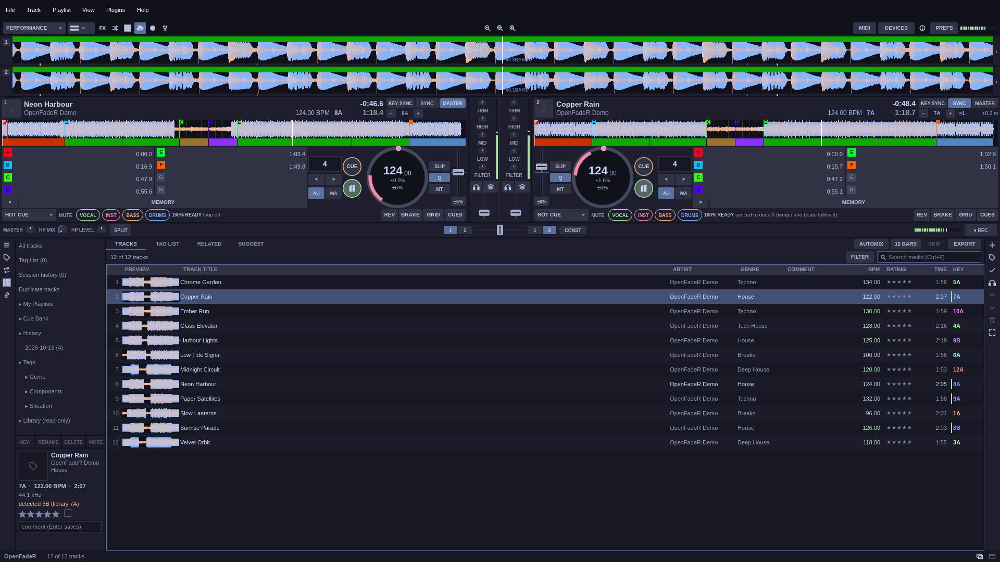
</p>

<p align="center">
  <a href="LICENSE"></a>
  <a href="https://github.com/OpenRsG/OpenFadeR/stargazers"></a>
</p>

OpenFadeR is an open-source DJ application for two or four decks, written in Rust with [Slint](https://slint.dev). It analyses your tracks, separates stems, mixes with effects and a sampler, and reads MIDI controllers from a growing set of mapping files. Themes, plugins and controller mappings install from GitHub repositories with one click.

<p align="center">
  
</p>

<p align="center"><a href="docs/media/demo.mp4">Watch the demo as MP4</a></p>

Every screenshot on this page comes from the running app, with a library of synthetic tracks generated for these pictures. There is no copyrighted music in them.

## Quick start

You need `git` and a [Rust toolchain](https://rustup.rs). There is no prebuilt release yet.

```sh
git clone https://github.com/OpenRsG/OpenFadeR.git
cd OpenFadeR
./start.sh ~/Music
```

The first run clones the plugins, themes and mappings next to the code, builds everything and opens the folder you gave as a library. You should see your tracks in the browser, with BPM, key and waveform previews filling in as the analysis finishes. Double-click a track to load it on deck 1, press `Space` to play.

`start.sh` without a path reopens the last library, or opens `$XDG_MUSIC_DIR` (else `~/Music/OpenFadeR`). To build only the core: `cargo build --release`.

## A tour

### Analysis that is ready when you load

BPM, beat grid, downbeat, key, a three-band waveform, phrases (intro, up, chorus, down) and automatic cues are computed in the background and cached. The pictures above show them: coloured phrase bars over the enlarged waveforms, hot cues A to H under each deck, and a key colour in the track list. Decks sync tempo and beats, key sync follows the key, and key lock keeps the pitch while you push the tempo.

### Two decks or four

<p align="center">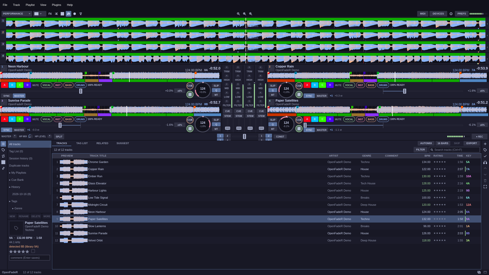</p>

Press `D` to switch layouts. All four decks get their own pads, loops, slip, sync and stem buttons. The deck layout (horizontal or vertical) is a VIEW setting, and a theme can ask for it.

### Effects

<p align="center">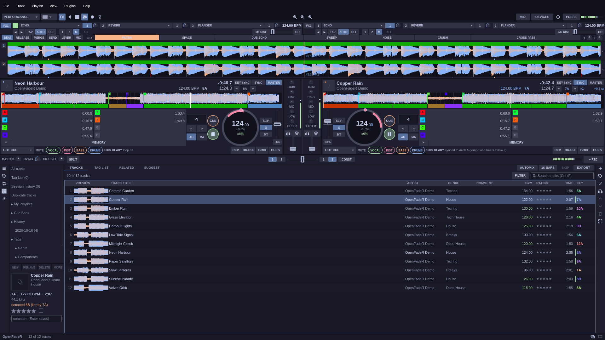</p>

Beat FX has several units with three slots each, tempo taken from the deck or tapped. COLOR FX (filter, space, dub echo, sweep, noise, crush, cross-pass) sits on every channel and MERGE FX works on the whole mix. More effects arrive through effect plugins.

### Sampler

<p align="center">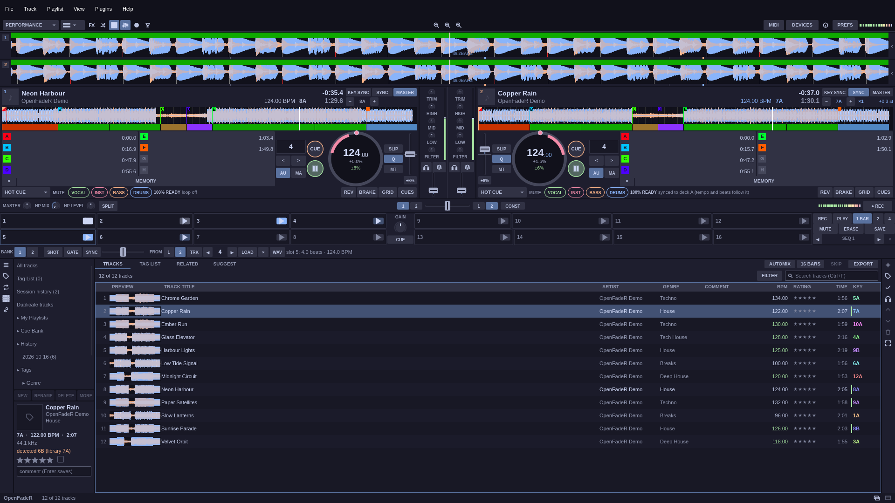</p>

Sixteen slots in two banks, loaded from a deck or from a file. Slots play as a shot or a gate, can follow the tempo, and a sequencer records and replays a pattern.

### Stems

<p align="center">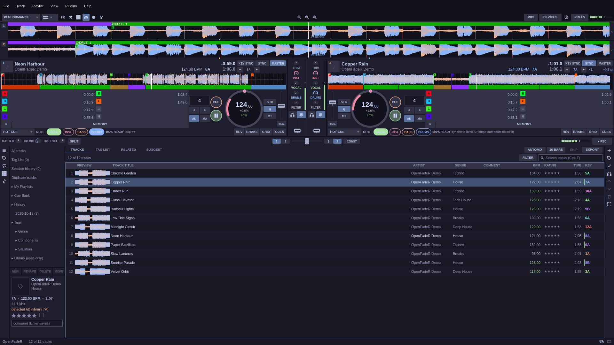</p>

Enable STEMS in PREFERENCES > EXTENSIONS and each loaded track is separated into vocal, instrument, bass and drums (a 3-stem mode exists too) by an ONNX model that runs on the CPU or the GPU. Mute or solo a stem per deck, or let the mixer's knobs act on stems. The waveform follows what you mute.

### BEAT LAB

<p align="center">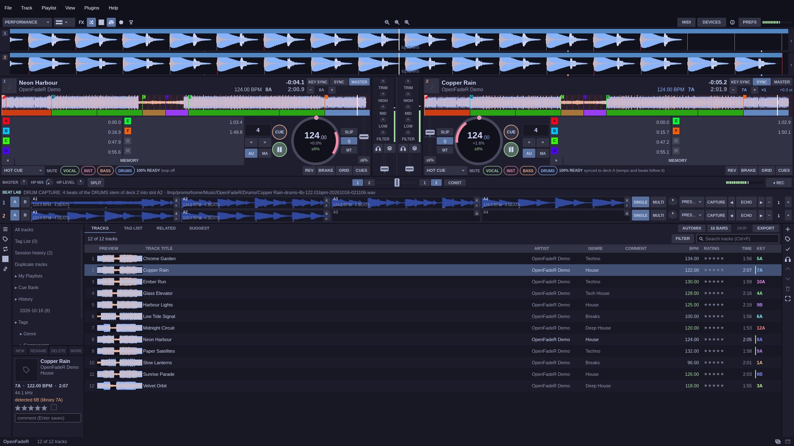</p>

BEAT LAB captures a few beats of a deck's drum stem into a slot. Fill the slots of a deck, swap between them, and drop drums from one track under the melody of another. It needs STEMS and is switched on in the same preferences page.

### A browser that suggests

<p align="center">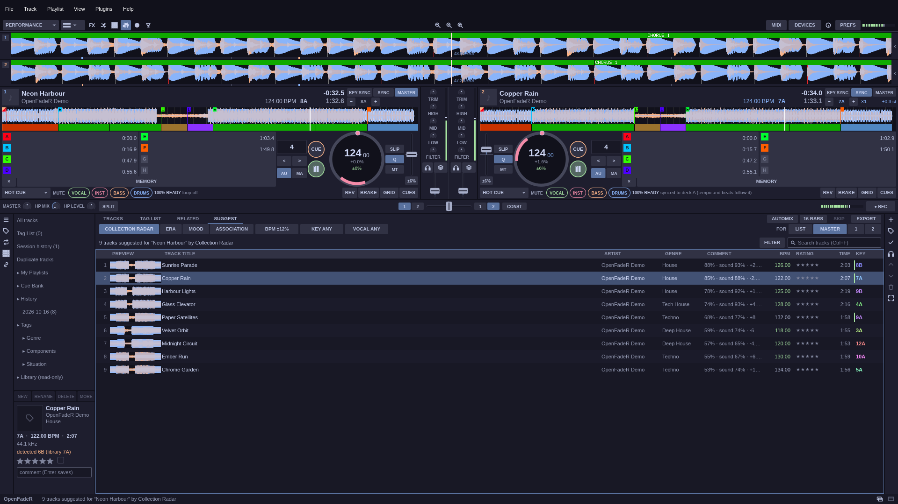</p>

The browser reads folders (subfolders become playlists) or library plugins, and has search, sortable columns, a track filter (BPM range, key match, rating), related tracks, a Tag List, smart playlists, history, a duplicate finder and a missing-file manager. The SUGGEST tab ranks the rest of your collection against the loaded track and shows a score for each, with filters for BPM and key. Your own edits (cues, loops, grid, rating, comment, colour) live in `store.db`; a library source is never written to.

### Edit mode

<p align="center">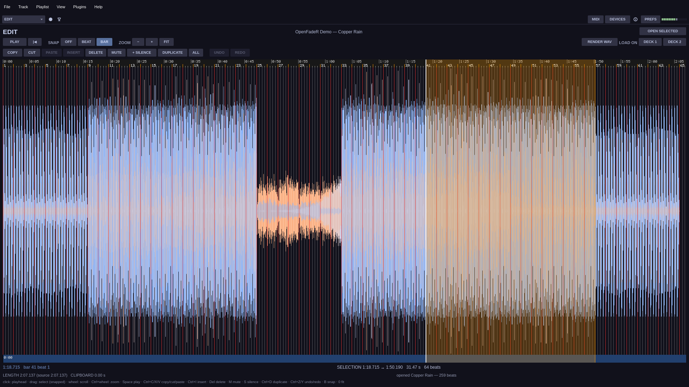</p>

EDIT shows the whole track with its beat grid. Select with snap to beat or bar, then copy, cut, paste, insert, delete, mute, duplicate or add silence, undo and redo, and render the result to a WAV file or load it on a deck.

### Lighting mode

<p align="center">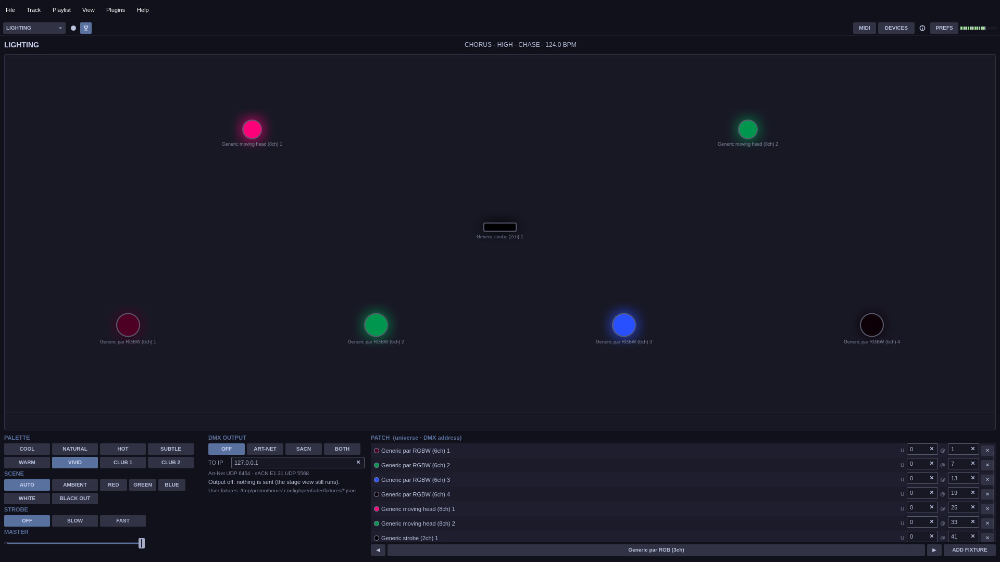</p>

LIGHTING patches fixtures (RGB pars, RGBW pars, moving heads, strobes) and drives them from the phrase that is playing, so a chorus looks different from a breakdown. Pick a palette and a scene, or let AUTO choose. DMX goes out over Art-Net or sACN, or nowhere: the stage view works without any hardware.

### Export and video

EXPORT mode shows cues and memory points for the two decks next to a DEVICES panel; USB sticks and SD cards are written by device plugins.

<p align="center">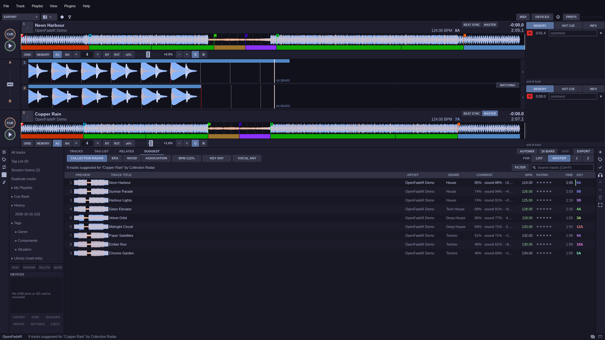</p>

VIDEO plays video tracks on an output window and crossfades between the two decks' pictures.

## Themes

<p align="center">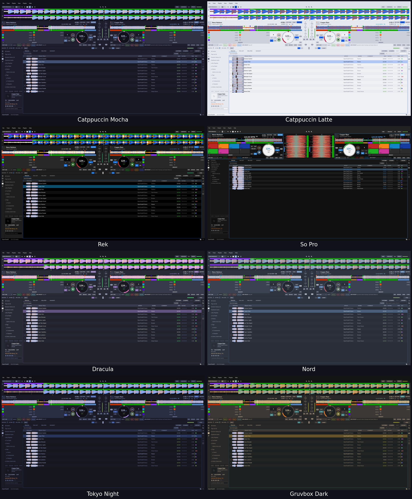</p>

The app ships with Catppuccin Mocha (the default) and Latte. The [OpenFadeR-Themes](https://github.com/OpenRsG/OpenFadeR-Themes) repository adds eleven more, so there are 13 in total. A theme can change colours, fonts, sizes and even the layout, and it applies at once. PREFERENCES > THEMES has an editor for every token with live preview, SAVE AS, and import.

<p align="center">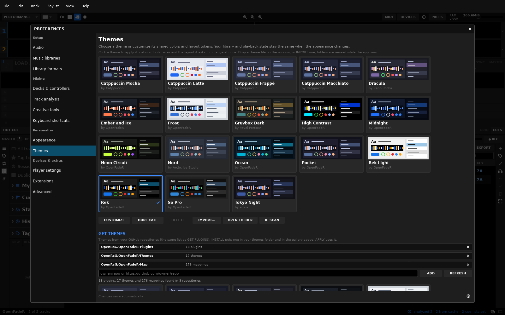</p>

## Plugins, themes and mappings

Three companion repositories feed the app, and PREFERENCES lists them from the first run:

| Repository | Holds | Where in the app |
| --- | --- | --- |
| [OpenFadeR-Plugins](https://github.com/OpenRsG/OpenFadeR-Plugins) | library, device, effect, action and source plugins (17 at the time of writing) | PREFERENCES > EXTENSIONS > GET PLUGINS |
| [OpenFadeR-Themes](https://github.com/OpenRsG/OpenFadeR-Themes) | themes | PREFERENCES > THEMES > GET THEMES |
| [OpenFadeR-Map](https://github.com/OpenRsG/OpenFadeR-Map) | MIDI controller mappings (more than 170 files) | PREFERENCES > CONTROLLER > GET MAPPINGS |

INSTALL installs one. Add any repository by its GitHub path (`user/name`) and the app finds the plugins, themes or mappings in it too, so sharing a theme is publishing a GitHub repository.

Plug in a controller that has no mapping yet and the app offers the matching file from the mapping repository: one click on INSTALL and the controller works. Mapping files cover the default layer of each controller; MIDI learn and LED feedback are built in, and hot-plug detection picks controllers up while the app runs. The format is described in [docs/mappings.md](docs/mappings.md).

## Keyboard shortcuts

One table drives dispatch and the `?` help overlay (Shift = deck B, Ctrl = deck C, Ctrl+Shift = deck D):

| Key | Action | Key | Action |
| --- | --- | --- | --- |
| Space | play/pause | K | key sync |
| Z / X | CUE A / CUE B | `-` / `=` / 0 | key down / up / reset |
| 1–8 | pads (per pad mode) | M | next pad mode |
| L | 4-beat loop | V / E / B | slip / reverse / brake |
| I / O / R | loop in / out / reloop | T | add to Tag List |
| `[` / `]` | beat jump −4 / +4 | ← / → | FX beat fraction |
| Enter | LOAD | F | FX on/off |
| S | SYNC | Ctrl+F | focus search |
| Q | MASTER | W / Shift+W | VIEW / Area |
| Up / Down | browser selection | ? | help overlay |
| G / Y / N | grid row / tap / beat 1 here | `,` / `.` | grid shift ∓1 ms |
| P | sampler strip | A / Shift+A | AUTOMIX on/off / skip |
| D | 2 / 4-deck layout | | |

The table is editable in PREFERENCES > KEYBOARD.

## Where things are found

Each kind is looked up in an environment-variable folder list (`:`-separated), a folder in the config directory, and the bundled folder next to the executable (or in a folder above it).

| Kind | Environment variable | Config folder | Bundled folder |
| --- | --- | --- | --- |
| Plugins | `OPENFADER_PLUGINS` | `~/.config/openfader/extension/plugin/` | `extension/plugin/` |
| Themes | `OPENFADER_SKINS` | `~/.config/openfader/extension/skin/` | `extension/skin/` |
| Controller mappings | `OPENFADER_MAPPINGS` | `~/.config/openfader/mappings/` | `mappings/` |

`start.sh` clones the three repositories into those bundled folders (git ignores them here) and the native plugins build with `extension/plugin/build.sh` against this checkout's `sdk/`. Settings live in `$XDG_CONFIG_HOME/openfader/` (default `~/.config/openfader/`), analysis in `$XDG_CACHE_HOME/openfader/analysis`.

### Linux, Windows and macOS

The docs write the Linux folders; the others follow their system's convention (`$XDG_*_HOME` wins on every OS when set):

| | Linux | macOS | Windows |
| --- | --- | --- | --- |
| Settings, your plugins, themes, mappings (`~/.config/openfader/` in these docs) | `~/.config/openfader/` | `~/Library/Application Support/openfader/` | `%APPDATA%\openfader\` |
| Store, downloaded plugin files | `~/.local/share/openfader/` | `~/Library/Application Support/openfader/` | `%LOCALAPPDATA%\openfader\` |
| Caches (analysis, stems, models) | `~/.cache/openfader/` | `~/Library/Caches/openfader/` | `%LOCALAPPDATA%\openfader\cache\` |

The release archives hold the bundled folders next to the executable (`OpenFadeR.app/Contents/Resources/` on macOS). Removable devices are found as USB sticks mounted below `/run/media` or `/media` (Linux), removable drive letters (Windows) and volumes below `/Volumes` (macOS); ejecting uses udisks, the volume's own eject request, or `diskutil`. Linux alone has the per-card volume sliders on the audio page (ALSA mixer, the sound server) and mounts a plugged stick itself (udisks): on Windows and macOS the volume is the system's and the OS mounts the stick. File choosers are zenity or kdialog on Linux, PowerShell's dialogs on Windows and `osascript` on macOS.

Audio, MIDI and folder behaviour can be set with `OPENFADER_OUTPUT_DEVICE`, `OPENFADER_HP_CHANNELS`, `OPENFADER_CUE_DEVICE`, `OPENFADER_MIDI_PORT`, `OPENFADER_MIDI_LOG`, `OPENFADER_JOG_TICKS`, `OPENFADER_TEMPO_INVERT`, `OPENFADER_REC_DIR`, `OPENFADER_EXPORT_DIR`, `OPENFADER_PATH_MAP` (audio path remap, `from=>to;…`) and `OPENFADER_DEVICE_ROOTS` (extra folders treated as devices).

## Documentation

- [docs/plugins.md](docs/plugins.md): plugin format and the library / device ABI, with the SDK in [`sdk/`](sdk/)
- [docs/skins.md](docs/skins.md): theme files, every token, layout hints
- [docs/mappings.md](docs/mappings.md): controller mapping files

The code follows `.omp/rules/code-structure.md`: one folder per section (`library/`, `analysis/`, `audio/`, `plugin/`, `app/`, …), a base `mod.rs` and one child per variant. Only `app/` and the `ui/` crate use Slint.

## Contributing

Bug reports, mapping files, themes and plugins are all welcome. Read [CONTRIBUTING.md](CONTRIBUTING.md) first; the [code of conduct](CODE_OF_CONDUCT.md) applies, and security reports go through [SECURITY.md](SECURITY.md). `cargo test --release` runs the tests, and the companion repositories' tests run too when they are checked out.

## License

AGPL-3.0, see [LICENSE](LICENSE).
